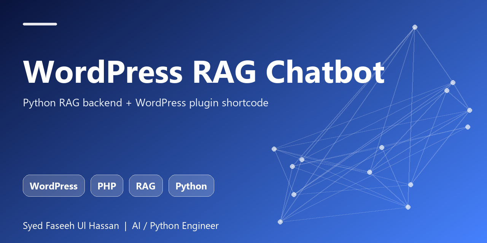

<p align="center"></p>

# WordPress RAG Chatbot

Answer visitor questions from your own WordPress content. A Python index ingests posts from the WP REST API; a small PHP plugin adds a `[rag_chatbot]` shortcode and a REST proxy to the backend.

  

## Features
- Ingests WP REST API post JSON, strips HTML
- TF-IDF-style ranking, answers link to source posts
- PHP plugin with `[rag_chatbot]` shortcode and REST proxy route
- Read-only endpoint with sanitised input

## Quick start
```bash
git clone https://github.com/FASEEHSYED786/wordpress-rag-chatbot.git
cd wordpress-rag-chatbot
pip install -e .[dev]
pytest
```

## Usage
```python
from wp_rag import SiteIndex

idx = SiteIndex(); idx.load_posts(posts_from_wp_rest)
print(idx.answer('How long do returns take?'))
```

## Why this exists
Part of my applied-AI portfolio (Python, RAG, LLM agents, evaluation, LLMOps). Built to be small, readable, tested and easy to extend with a real LLM or vector store.

## Author
**Syed Faseeh Ul Hassan** - Python / AI engineer, MSc AI & Big Data - Cambridge, UK
Website: [syedfaseeh.com](https://syedfaseeh.com) - [LinkedIn](https://www.linkedin.com/in/syed-faseeh-ul-hassan-809595103/)

MIT licensed.
